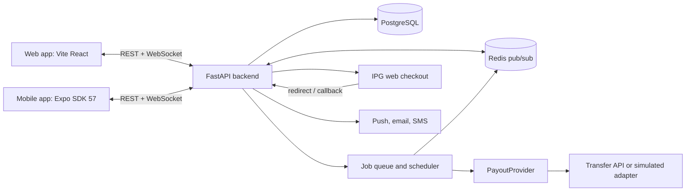
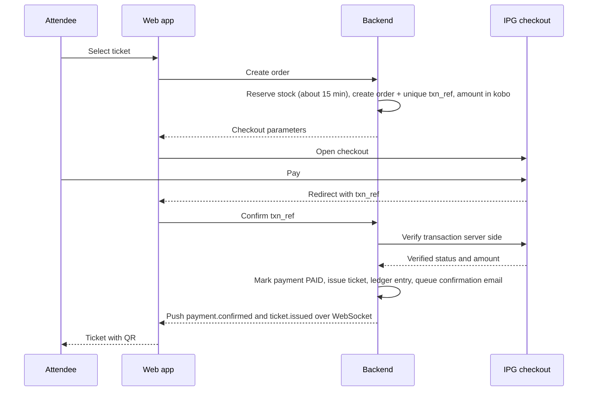
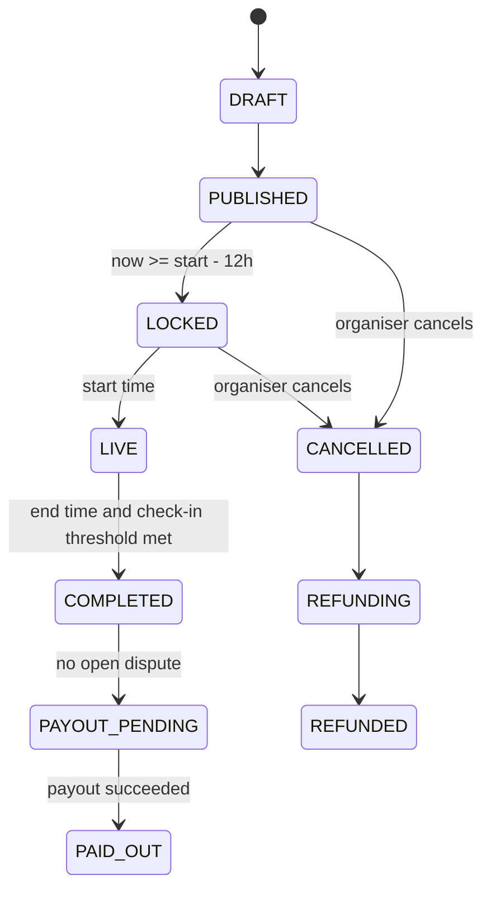

# InterPay: Architecture

Product name: InterPay. Event registration with escrow and payouts. Hackathon POC for the Interswitch Discovery Series (PHEARTS + XB).

## 1. Summary

Attendees register and pay for events through the Interswitch Payment Gateway (IPG) web checkout. Money is held by the platform until the event outcome is known.

- The **event creator decides whether attendees can cancel**.
- If cancellation is allowed, attendees can cancel for a refund only up to **12 hours before the event starts**. After that cutoff, tickets are locked and the money is committed to the event.
- If cancellation is not allowed, tickets are non-refundable, except when the organiser cancels the event.
- The **event creator also decides how people attend**: physically, online, or both.
- After every successful purchase the system **sends a confirmation email**, and the ticket also shows on screen.
- Each event has its own **public page** at `/event/{slug}/{year}` with flyers, location and contact details.
- A platform **admin screen** oversees organisers, events, payments, refunds, payouts and email delivery.
- If the event **happens**, the organiser receives a **payout** of the held funds minus fees.
- If the event is **cancelled by the organiser**, every attendee is refunded in full.

So there are two payout types: **refund payouts** to attendees, and an **organiser payout** after the event.

## 2. Goals and non-goals

Goals
- Live IPG checkout (hackathon requirement), starting from as little as 10 naira.
- Enforced cancellation window, server side.
- Clear, auditable money trail (ledger) for every kobo.
- Fake ticket prevention and reliable check-in, including weak network.
- Live updates pushed to every client over one persistent connection (WhatsApp style), with no polling.
- A working live demo in under 3 minutes.

Non-goals (for the POC)
- Becoming a licensed payment institution. Funds are shown as "held pending event outcome", with the licensed partner path described in the pitch.
- Multi-currency settlement and tax invoicing.

## 3. Assumptions to confirm

1. **Payout capability.** The IPG web checkout guide covers collection only. Programmatic refunds and organiser payouts need a transfer or disbursement API. Confirm with the Interswitch contact whether teams get access. Until confirmed, payouts go through a `PayoutProvider` interface with a **simulated adapter**, clearly labelled in the demo.
2. **"Event happens" definition.** Proposed: the event end time has passed AND at least one valid check-in exists, either a physical QR scan or an online join (threshold configurable) AND no open dispute. Confirm this rule.
3. **Transaction fee.** IPG adds a transaction fee to the checkout amount. Decide who bears it (attendee, organiser, platform) and whether refunds include it.
4. **Platform fee.** Proposed: a small percentage taken at organiser payout.
5. **Hosting.** The backend must run on a long-lived server process that supports WebSockets and public HTTPS (IPG callbacks need a public URL). Short-lived serverless functions are not suitable for the real-time layer.

## 4. System overview



### 4.1 Stack and clients

- **Web (Vite + React):** organiser dashboard and attendee web experience.
- **Mobile (React Native on Expo SDK 57, React Native 0.86):** attendee tickets with QR codes, and an organiser scanner mode using the camera.
- **Backend (FastAPI):** Pydantic v2 schemas, SQLAlchemy 2 with Alembic migrations, native WebSocket support.
- **Database:** PostgreSQL.
- **Real-time fan-out and jobs:** Redis (pub/sub for sockets) with a background worker (Celery or ARQ) for scheduled and retryable work.
- **Mobile testing note:** Expo SDK 57 was released on 30 June 2026. The store version of Expo Go may lag behind, so test early with a development build, or with the options in the Expo SDK 57 changelog (`eas go` for iOS devices, Expo CLI for Android and simulators).

Suggested monorepo layout, so both frontends share the same code for talking to the backend:

```
apps/web                 Vite + React
apps/mobile              Expo (React Native)
packages/api-client      Typed REST client generated from the FastAPI OpenAPI schema
packages/realtime        WebSocket client: connect, reconnect, resume, subscribe
backend/                 FastAPI
```

Browsers and React Native both ship a built-in `WebSocket`, so one `packages/realtime` library works on web and mobile.

### 4.2 Real-time connection (WhatsApp style)

Instead of the apps hitting the API every few seconds, each app opens **one persistent WebSocket** after login. The server pushes changes the moment they happen, such as a payment confirmed, a refund completed, or a new check-in on the organiser dashboard.

Principles
- **REST for commands, WebSocket for push.** Money actions (create order, cancel, payout) stay on REST because they need clear responses, status codes and idempotency keys. The socket carries notifications and live state.
- **The database is the source of truth.** A socket message is a notification of a change, never the only copy of a fact. If the socket is down, the app can always refetch over REST.
- **One connection per app, many topics multiplexed over it.**

Connection lifecycle
- **Endpoint:** `WS /ws` on the FastAPI backend.
- **Auth:** the client first calls `POST /ws/ticket` and receives a single-use ticket that expires in about 30 seconds, then connects with it. This avoids putting a long-lived token in the URL, since browsers cannot set headers on WebSocket connections.
- **Heartbeat:** ping and pong about every 25 seconds. The server drops dead sockets after missed pongs. Clients reconnect with exponential backoff and jitter.
- **Resume:** every event carries an increasing `seq`. The client remembers the last `seq` it saw and sends `{"type": "resume", "last_seq": N}` after reconnecting. The server replays missed events from the `event_outbox` table. If the gap is too old, it tells the client to refetch over REST.
- **Acks:** the client acknowledges critical events. Scanner check-ins sent over the socket get an ack with the result, with REST as the fallback.

Event envelope

```json
{ "seq": 1042, "type": "payment.confirmed", "topic": "user:81", "ts": "2026-11-08T10:15:00Z", "data": { "order_id": 220, "ticket_ids": [301] } }
```

Topics and events

| Topic | Who subscribes | Events |
| --- | --- | --- |
| `user:{id}` | The user's own devices | `payment.confirmed`, `ticket.issued`, `refund.processing`, `refund.completed`, `event.updated`, `event.locked` |
| `event:{id}` | The event's organiser (authorised per subscribe) | `sale.recorded`, `checkin.recorded`, `event.completed`, `payout.processing`, `payout.completed` |
| `admin` | Admin role only | `order.paid`, `email.failed`, `payout.failed`, `report.submitted` |

Reliability rules
- **Outbox pattern:** the `event_outbox` row is written in the same database transaction as the state change, then published to Redis after commit. This prevents "money moved but no push was sent".
- **Multi-instance fan-out:** any API worker or background job publishes to Redis. The server process holding the user's socket delivers the message, so no sticky sessions are needed.
- **Backgrounded apps:** phones close sockets when an app goes to the background, which is why WhatsApp also relies on push notifications. Use Expo push notifications on mobile (payment confirmed, refund done, cancellation deadline reminder) with email or SMS as fallback. When the app opens, it reconnects and resumes from its last `seq`.
- **Why WebSocket and not Server-Sent Events:** SSE is one-way. The scanner needs two-way messages with acknowledgements.

## 5. Product requirements

### 5.1 Event creation (organiser)

| Field | Notes |
| --- | --- |
| Title, description, category | Category examples: community, health outreach, agriculture fair, campus, faith, tech |
| Cover image and flyers | A cover image plus any number of flyer images (and an optional PDF flyer), stored in object storage |
| Start, end, timezone | Stored in UTC, shown in the event timezone (Africa/Lagos by default) |
| **Attendance mode** | Physical only, online only, or both. Decided by the creator |
| Venue | Name, address, map link, physical capacity (shown for physical or both) |
| Online details | Platform, join link, online capacity (shown for online or both). Hidden from the public page, released only to paid attendees |
| **Ticket categories** | The creator can add as many as needed (for example Regular, VIP, Student, Online pass). Each has a name, description, price in naira (stored in kobo, 0 for free), quantity, sales window, max per order, and optionally which attendance modes it covers. Categories can be reordered, hidden or closed. A free category skips checkout |
| Max tickets per order | Default cap, can be overridden per category |
| **Cancellation** | A single toggle: attendees can cancel (up to 12 hours before the start) or cannot cancel |
| Custom questions | Optional extra fields such as dietary needs or organisation |
| Contact | Organiser name, email, phone, WhatsApp number and social links, shown on the event page |
| Visibility | Public listing or unlisted link |
| Payout account | Bank, account number, verified account name. Stored encrypted, used only for the organiser payout |

Each event gets its own public page at `/event/{slug}/{year}` (see 5.7) and a QR poster that links to it.

### 5.2 Rules the creator controls

**Cancellation toggle**
- If **on**: attendees can cancel until 12 hours before the start and get a refund payout.
- If **off**: attendees cannot cancel and tickets are non-refundable. The cancel button is hidden and the page explains why. If the organiser cancels the event, everyone is still refunded in full.
- The policy is shown on the event page and again at checkout. The attendee must tick an acceptance box before paying.
- Each order stores a **policy snapshot** (the toggle value and deadline at purchase time). If the organiser changes the setting later, it only affects new orders, never people who already paid.

**Attendance mode**
- Physical only: no mode choice is shown. Attendees receive a QR ticket for the door.
- Online only: no mode choice is shown. Attendees receive a personal join link.
- Both: the registration form asks each buyer to choose physical or online. Capacity is counted per mode.
- Online attendance is tracked through the personal join link (`/join/:token`). A join counts as a check-in toward the "event happens" rule.

### 5.3 Registration form (attendee)

| Field | Rules |
| --- | --- |
| First name | Required |
| Last name | Required |
| Email | Required, format validated. The confirmation goes here |
| Phone number | Required, Nigerian numbers normalised to +234 format, other countries accepted for diaspora buyers |
| Number of tickets | Per category: a stepper with a minus button, a numeric text field, and a plus button |
| Attendance mode | Physical or online. Shown only when the creator allows both |
| Guest names | Optional per ticket when buying more than one |
| Custom questions | As set by the creator |
| Policy acceptance | Required checkbox showing the cancellation policy |

Ticket quantity stepper behaviour
- With one category the stepper starts at 1 and the minus button is disabled at 1. With several categories each row starts at 0, and checkout stays disabled until the total is at least 1.
- The text field accepts digits only (numeric keypad on mobile). Pasted or typed values are clamped to the allowed range.
- Each category has its own stepper. Maximum is the smaller of that category's max per order and the tickets still available. The plus button disables at the maximum, with a short message explaining why.
- An order can include several categories. At least one ticket overall is required.
- The total updates live. A note explains that the payment gateway may add a transaction fee at checkout.

### 5.4 Confirmation and notifications

**The system must send a confirmation email after every successful purchase.** Once the payment is verified, the attendee receives:
- **Confirmation email:** event name, date and time with timezone, venue or online join link, number of tickets, QR code for each ticket (inline image plus a link to the ticket page), order reference, amount paid, the cancellation policy (with the cancel link and deadline when allowed), an add-to-calendar file (.ics), and organiser contact.
- **On-screen confirmation** with the same ticket details, delivered instantly through the real-time connection.
- **Optional SMS** with a short ticket link.

Other messages
- Reminder 24 hours before the event.
- Refund confirmation when an attendee cancels.
- Event cancelled notice with refund details.
- Event updated notice when the time or location changes.

Delivery guarantees
- Sent within seconds by a background worker, through a small `Mailer` interface so any transactional email provider can be used.
- Retries with backoff if the provider fails. Every attempt is recorded in `notifications`, and a unique key per order prevents duplicate sends.
- Delivery status (sent, delivered, bounced) is tracked through provider webhooks where available.
- If sending still fails after the retries, the order is flagged on the admin screen and the attendee can still open the ticket on screen. The attendee, organiser and admin can all trigger a resend.
- The email includes a signed ticket link, so no login is needed to open the ticket.
- Plain-text version included, and the sending domain is authenticated (see section 7).
- Free tickets get the same confirmation email.

### 5.5 Screens

Attendee
- Event page, registration and checkout, ticket page with QR or join button, my tickets, cancel flow.

Organiser
- Create and edit event, attendee list with search and filters (mode, status), CSV export, resend confirmation, live sales and check-in counts, ledger, payout status.

Scanner (mobile app)
- Camera scan, offline manifest, result screen (valid, already used, invalid).

Admin
- See 5.6.

### 5.6 Admin screen (platform admin)

A separate admin area for the InterPay team, available to the `admin` role only. Every action is written to the audit log.

| Area | What the admin can do |
| --- | --- |
| Dashboard | Live totals from real data: tickets sold, gross sales, funds held, refunded, paid out, platform fees. Updates through the real-time connection |
| Organisers | Review new organisers, approve or suspend, verify the payout account name before the first payout |
| Events | Search all events, see status, unpublish or take down a fraudulent event, force-cancel with full refunds |
| Orders and payments | Search by reference, email or phone. See the IPG verification result. Reconcile orders that were paid but never confirmed |
| Refunds and payouts | Queues with status. Retry failed items, hold or release a payout, mark clearly when running in simulated payout mode |
| Notifications | Email delivery log, bounced or failed sends, resend |
| Disputes and reports | Attendee reports against an event, with the option to put the payout on hold |
| Users and roles | Manage admins, organisers, staff accounts |
| Settings | Platform fee percentage, default cancellation window (12 hours), reservation time, feature flags |
| Audit log | Searchable history of every money-related and admin action |

Access rules: admin accounts are created by seeding or by another admin, never by public sign-up. Two-factor authentication is recommended.

### 5.7 Public event page and URL

Every published event has its own page.

**URL format:** `/event/{slug}/{year}`, for example `/event/lead-city-tech-week/2026`.
- `slug` is lowercase letters, digits and hyphens, generated from the title and editable by the organiser.
- `year` is the year of the event start date in the event timezone.
- The pair `(slug, year)` is unique, so the same event name can return next year at `/event/lead-city-tech-week/2027`.
- Reserved words are blocked as slugs. If the slug or year changes after publishing, the old URL redirects permanently to the new one. Unknown URLs show the custom 404 page.
- The mobile app opens the same URL through universal links and app links, with the web page as the fallback.

**Page content**
- Title, date and time with timezone label, and a badge for physical, online or both.
- **Flyers:** a gallery of the creator's flyer images (zoom and download).
- About text, optional agenda and FAQ.
- **Ticket categories:** name, description, price, availability (available, sold out, sales not started, sales ended) and the quantity steppers with the register button.
- **Location:** venue name, full address, map and a directions button. For online events, the platform name is shown and the join link stays hidden until purchase.
- **Contact information:** organiser name, email, phone, WhatsApp and social links.
- Cancellation policy summary, share buttons and an add-to-calendar button.
- Clear states for cancelled, ended and sold-out events. Drafts are visible only to the organiser as a preview.

**Search and sharing**
- Unique page title and main heading per event, plus a canonical URL.
- Open Graph and Twitter card tags using the first flyer as the image, so shared links look right on WhatsApp.
- Event JSON-LD with location, offers per category, attendance mode and event status.
- Listed in `sitemap.xml` when the visibility is public.

## 6. Brand and UI standards

### 6.1 Identity
- **Name:** InterPay.
- Make clear in the pitch and in the footer that InterPay is a hackathon project built on the Interswitch Payment Gateway, not an official Interswitch product.
- **Look:** blue and white, clean and trustworthy, generous whitespace.

### 6.2 Typography
- **Font:** Sora (weights 400, 500, 600, 700). Fallback stack: system-ui, sans-serif.
- Web: self-host with `@fontsource/sora`.
- Mobile: `@expo-google-fonts/sora` loaded with `expo-font`.

### 6.3 Colour tokens (starting palette, adjust as needed)

| Token | Value | Use |
| --- | --- | --- |
| `blue-600` | `#1F4FD8` | Primary buttons, links (white text on it is about 6.6:1 contrast) |
| `blue-700` | `#173DB0` | Hover and pressed |
| `blue-50` | `#EEF3FF` | Soft backgrounds, selected states |
| `ink` | `#0B1B3F` | Body text |
| `border` | `#D9E2F7` | Inputs and dividers |
| `white` | `#FFFFFF` | Page and cards |
| `success`, `danger` | green and red | Status only |

### 6.4 Component and content rules
- Buttons are rectangles with a small corner radius, not pill-shaped.
- Icons come from a line icon set, never emoji.
- Only blue and white as the brand colours. No purple gradients.
- Hero text states exactly what InterPay does, with a clear primary action.
- No fake previews, no invented statistics, no placeholder text anywhere.
- No em dashes in any copy.
- Use motion sparingly. No scroll-triggered animation on every section.
- No "made with AI" badges.

### 6.5 Web app checklist (Vite + React)
- Terms and Conditions page and Privacy Policy page. The privacy policy covers the name, email, phone and payment references collected, in line with Nigerian data protection law (NDPA 2023).
- Custom 404 page.
- Favicon present.
- Unique page title and unique main heading on every page.
- Clean semantic HTML (header, nav, main, section, footer, labelled form fields).
- `sitemap.xml` and `robots.txt`.
- Structured data: schema.org `Event` JSON-LD on each public event page, using `eventAttendanceMode` (`OfflineEventAttendanceMode`, `OnlineEventAttendanceMode`, or `MixedEventAttendanceMode`) to match the creator's choice.
- Remove default Vite and React branding from the tab title, favicon and links.
- Production builds ship without source maps.

## 7. Additional requirements (easy to miss)

**Checkout and stock**
- **Guest checkout.** Buyers do not need an account. Tickets are reached through the signed email link, and a "Find my tickets" page sends a one-time code to the buyer's email or phone.
- **Stock reservation.** Tickets are held for about 15 minutes while the buyer pays, then released if payment does not complete. Stock is decremented atomically so a category can never oversell.
- **Late payments.** If a payment completes after the hold expired, the order is either honoured (if stock remains) or refunded automatically.
- **Sold-out waitlist** (optional): buyers leave an email and are notified if tickets free up.

**Payments**
- **Reconciliation.** A scheduled job compares orders with IPG records to catch payments that succeeded but never reached the backend.
- **Receipts.** The confirmation email doubles as the payment receipt, with the order reference and amount.
- **Chargebacks and disputes** are flagged to the admin screen and can hold the organiser payout.

**Changes to an event**
- If the organiser materially changes the date, venue or attendance mode, attendees are notified and get a fresh refund window, even when cancellation is normally disabled. This is fair to buyers and avoids disputes. Confirm this rule.
- Duplicate an event for next year with the same slug and a new year.

**Organiser tools**
- Team roles: owner, manager, and scanner-only staff accounts for door duty.
- Promo codes (optional), sales over time, attendee export.

**Trust and safety**
- Organisers are approved by an admin and their payout account is verified before their first payout.
- A "report this event" button on every event page.
- Bot protection and rate limits on registration and on the one-time-code endpoints.

**Email deliverability**
- Send from a verified domain with SPF, DKIM and DMARC set up, otherwise confirmations land in spam.
- Test with real inboxes (Gmail, Yahoo, Outlook) before demo day. Handle bounces and complaints.

**Privacy**
- Consent shown at registration. Organisers can only see attendees of their own events.
- Data export and deletion on request, and a defined retention period.

**Operations**
- Separate test and live configuration for IPG keys, switched through environment variables.
- Error monitoring, structured logs with request IDs, a health check endpoint, and database backups.
- A demo seed script that creates sample organisers, events, categories and flyers.
- Automated tests for the money paths: cancellation rule, payout calculation, idempotency, stock reservation.

**Support and trust pages**
- Help and contact page, FAQ, refund policy page (alongside Terms and Privacy).

**Localisation**
- Prices formatted in naira. Dates shown in the event timezone with a label. English first.

**Priority for the hackathon**

| Must have for the demo | Nice to have |
| --- | --- |
| Live IPG checkout with server verification | Promo codes |
| Ticket categories (unlimited) and quantity steppers | Waitlist |
| Confirmation email with QR, retries and delivery log | Ticket transfer and name change |
| Public event page at `/event/{slug}/{year}` with flyers, location, contact | Team roles beyond scanner staff |
| Cancellation toggle and the 12 hour rule | Analytics charts |
| Physical, online, both, with join links | Event duplication |
| Real-time updates | Waitlist notifications |
| Organiser payout and refunds (live or labelled simulation) | |
| Basic admin screen (organisers, payments, payouts, email log) | |
| Terms, Privacy, 404, favicon, sitemap | |

## 8. Core flows

### 8.1 Registration and payment



Rules
- Amounts are stored and sent in **kobo** (integer). Never floats.
- The client's "success" is never trusted. The backend always verifies the transaction with IPG and checks the amount and reference match the order.
- Order confirmation is **idempotent** on `txn_ref`, so double callbacks do not create double tickets.
- Per-team merchant code and payable name come from environment variables, never from the repo.
- The confirmation email is sent by a background job after payment is verified. A `notifications` row makes it idempotent, so retries never send duplicates.

### 8.2 Cancellation (the 12 hour rule)

- First check the order's policy snapshot: if `cancellation_allowed` is false, return a clear "this event is non-refundable" error. No deadline applies.
- `cancel_deadline = event.start_at - 12 hours` (stored in UTC, event timezone Africa/Lagos for display).
- On a cancel request, the backend checks `now <= cancel_deadline`. This check is **authoritative at request time**. The scheduler only handles notifications and state changes, so a late job never lets a cancellation through.
- If allowed: ticket moves to `CANCELLED`, a `refund` record is created, and a refund payout is queued.
- If not allowed: the API returns a clear error with the deadline.
- If the organiser changes the start time materially, attendees get a fresh free cancellation window based on the new time.

### 8.3 Organiser cancels the event

- Event moves to `CANCELLED`.
- Every `PAID` ticket gets a full refund payout (no deadline applies).
- Organiser payout is blocked.

### 8.4 Check-in

- Each ticket carries a **signed QR token** (ticket id + HMAC signature). Rotating or short-lived tokens reduce screenshot sharing.
- The scanner calls the check-in endpoint. A unique constraint on `ticket_id` in `check_ins` guarantees a ticket can only be admitted once.
- **Weak network mode:** the scanner downloads the signed ticket list for the event before doors open, validates locally, and syncs check-ins when back online. Conflicts resolve to first scan wins.

### 8.5 Organiser payout



Payout amount = sum of tickets still `PAID` (not refunded) minus platform fee (and fees per assumption 3). Payout is created once per event (unique constraint), sent through `PayoutProvider`, and retried safely using its idempotency key.

## 9. Data model

| Table | Key fields |
| --- | --- |
| users | id, role (attendee, organiser, admin), email, phone |
| events | id, organiser_id, slug, year (unique with slug), title, description, category, cover_image_url, start_at, end_at, timezone, status, cancellation_allowed, cancel_deadline, attendance_mode (PHYSICAL, ONLINE, BOTH), venue_name, venue_address, map_url, physical_capacity, online_url, online_platform, online_capacity, max_per_order, visibility, contact_email, contact_phone, min_checkins |
| ticket_types (categories) | id, event_id, name, description, price_kobo (0 allowed for free), quantity, max_per_order, allowed_modes, sales_start, sales_end, sort_order, is_hidden |
| order_items | id, order_id, ticket_type_id, quantity, unit_price_kobo |
| reservations | id, order_id, ticket_type_id, quantity, expires_at |
| event_media | id, event_id, kind (FLYER, GALLERY, COVER), url, sort_order |
| slug_redirects | id, event_id, old_slug, old_year |
| team_members | id, event_id, user_id, role (owner, manager, scanner) |
| orders | id, user_id, event_id, txn_ref (unique), amount_kobo, quantity, first_name, last_name, email, phone, attendance_mode, policy_snapshot (cancellation_allowed, cancel_deadline), policy_accepted_at, status |
| payments | id, order_id, provider_ref, verified_amount_kobo, status, raw_response |
| tickets | id, order_id, ticket_type_id, status, attendance_mode, guest_name (optional), qr_secret, join_token (online) |
| check_ins | id, ticket_id (unique), method (QR_SCAN, ONLINE_JOIN), scanned_at, scanner_id |
| refunds | id, ticket_id, amount_kobo, status, provider_ref, idempotency_key |
| payouts | id, event_id (unique), amount_kobo, fee_kobo, status, provider_ref |
| ledger_entries | id, event_id, type, amount_kobo, ref_type, ref_id, created_at |
| audit_log | id, actor, action, entity, before, after, at |
| event_outbox | seq (auto increment), topic, type, payload, created_at |
| event_questions | id, event_id, label, type, required (optional custom questions) |
| answers | id, order_id, question_id, value |
| payout_accounts | id, organiser_id, bank_code, account_number (encrypted), account_name, verified |
| notifications | id, type, channel, to, ref_type, ref_id, status, provider_id, sent_at |

Ledger entry types: `TICKET_SALE`, `REFUND`, `PLATFORM_FEE`, `ORGANISER_PAYOUT`. The event's held balance is always the sum of its ledger entries, so the dashboard and payout never disagree.

## 10. API sketch

Attendee
- `GET /events`, `GET /events/:id`
- `GET /events/:slug/:year` public event page data (also resolves old slugs with a redirect)
- `POST /tickets/lookup` request a one-time code to find tickets
- `POST /orders` create order (first_name, last_name, email, phone, quantity, attendance_mode, ticket_type_id, accepted_policy) and return checkout parameters
- `POST /orders/:id/resend-confirmation`
- `GET /join/:token` records an online join, then redirects to the meeting link
- `POST /orders/:id/confirm` verify with IPG and issue tickets
- `GET /tickets`, `POST /tickets/:id/cancel`

Organiser
- `POST /events`, `PATCH /events/:id`, `POST /events/:id/cancel`
- `GET /events/:id/sales`, `GET /events/:id/ledger`, `GET /events/:id/payout`
- `GET /events/:id/attendees` (search and filter by mode and status), `GET /events/:id/attendees.csv`
- `POST /events/:id/attendees/:ticket_id/resend` resend confirmation
- `PUT /organiser/payout-account`
- `POST /events/:id/categories`, `PUT /categories/:id`, `DELETE /categories/:id`
- `POST /events/:id/media` upload flyers, `DELETE /media/:id`

Scanner
- `GET /events/:id/manifest` signed ticket list for offline use
- `POST /checkins` single or batch sync

Admin
- `GET /admin/stats`
- `GET /admin/organisers`, `POST /admin/organisers/:id/approve`, `POST /admin/organisers/:id/suspend`
- `GET /admin/events`, `POST /admin/events/:id/unpublish`, `POST /admin/events/:id/cancel`
- `GET /admin/payments`, `POST /admin/payments/:id/reconcile`
- `GET /admin/refunds`, `GET /admin/payouts`, `POST /admin/payouts/:id/hold`, `POST /admin/payouts/:id/release`, `POST /admin/payouts/:id/retry`
- `GET /admin/notifications`, `POST /admin/notifications/:id/resend`
- `GET /admin/audit-log`, `PUT /admin/settings`

Real-time
- `POST /ws/ticket` issues a single-use connection ticket
- `WS /ws` persistent connection (subscribe, resume, ack)

Internal
- `POST /webhooks/ipg` (if the gateway supports callbacks), signature verified

## 11. Scheduled jobs

| Job | Trigger | Action |
| --- | --- | --- |
| Reminder | event start minus 24h | Email all attendees; mention the cancellation deadline only when cancellation is allowed |
| Lock events | event start minus 12h | Set status LOCKED, close cancellations |
| Complete events | event end time | Evaluate check-in threshold, set COMPLETED |
| Release payout | after completion, no dispute | Create and send organiser payout |
| Retry payouts | every few minutes | Retry failed refunds and payouts with the same idempotency key |
| Expire reservations | every minute | Release held stock for unpaid orders |
| Retry emails | every few minutes | Retry failed confirmation emails with backoff |
| Reconcile payments | hourly and daily | Compare orders with IPG records, flag mismatches to admin |

## 12. Security and reliability

- Verify every payment server side. Match reference, amount, and status.
- Idempotency keys on orders, refunds and payouts. Unique DB constraints as the final guard.
- Role-based access: organisers only see their own events and ledger.
- WebSocket: single-use short-lived connection tickets, topic authorisation checked on every subscribe, and limits on message size and rate.
- Signed QR tokens, server-side single-use check-in.
- Secrets (merchant code, payable name, signing keys) in environment variables.
- Audit log for every state change involving money.
- Rate limiting on auth, order and check-in endpoints.
- Store only what is needed. No card data ever touches the platform (checkout is hosted by IPG).

## 13. Optional emerging-tech layer (only if time allows)

- **AI organiser risk check:** flags new organisers with suspicious patterns (no history, unusually high ticket prices, reused details) for admin review. Rules-based first, model second.
- **Hash-stamped receipts:** anchor a hash of each event's final ledger to a public chain for tamper evidence. This is an audit trail, not a legal record.

## 14. Demo script (about 3 minutes)

1. Organiser creates an event starting in a few hours (use a short test window for the 12 hour rule, with a clearly labelled demo clock).
2. Two attendees buy tickets with live IPG checkout (10 naira).
3. One attendee cancels inside the window: refund payout shown.
4. The cutoff passes: cancel button disabled with the deadline message.
5. Scanner admits the second attendee, rejects a duplicate scan.
6. Event completes: organiser payout appears with the full ledger breakdown.
7. Show an organiser cancellation case in one slide or a quick toggle.
8. Show a second event with cancellation disabled (non-refundable notice at checkout, no cancel button) and an online attendee joining through a personal join link.
9. Open the confirmation email from the first purchase, then show the admin screen: organiser approval, payment status, payout queue and the email delivery log.

## 15. Build order

1. Auth, events, ticket categories, orders with stock reservation and live IPG checkout with server verification.
2. Confirmation email pipeline (queue, retries, delivery log) so a purchase always produces an email.
3. Public event page at `/event/{slug}/{year}` with flyers, location, contact, share tags and structured data.
4. Ledger and cancellation rule (creator toggle, 12 hour cutoff) with refund records.
5. Real-time layer (WebSocket, Redis fan-out, outbox, reconnect and resume), then QR check-in and online join links with the mobile scanner.
6. Scheduler, completion rule, organiser payout.
7. `PayoutProvider` real adapter if the transfer API is available, otherwise the labelled simulation.
8. Admin screen (organisers, payments, payouts, email log), then support and legal pages.
9. Polish, demo seed data, pitch deck (PowerPoint format, named after the team).
